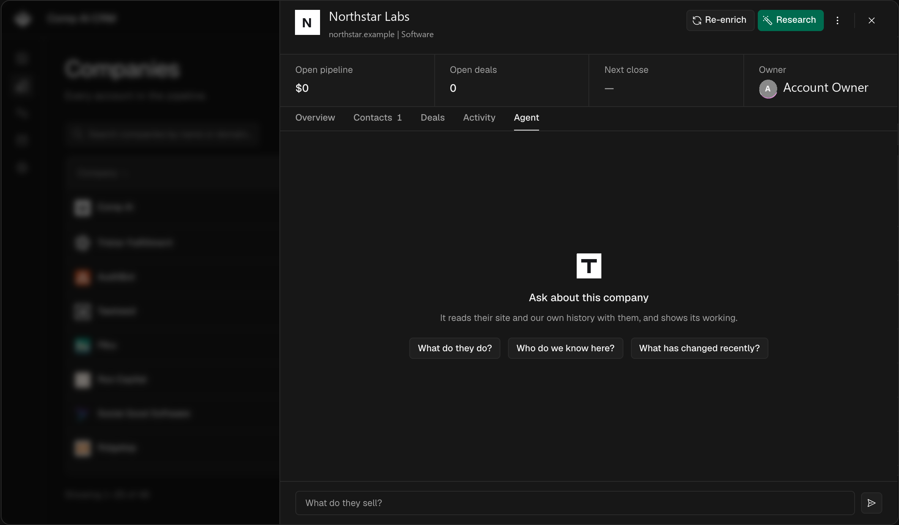

<h1 align="center">Threadline</h1>

<p align="center">
  <strong>Your conversations, turned into closed deals.</strong><br>
  An agentic CRM built on Gemini, Google ADK and Cloud Run for the Google Cloud AI Builder Cup 2026.<br>
</p>

<p align="center">
  <a href="#google-cloud-ai"><strong>Google Cloud AI</strong></a> ·
  <a href="#what-this-includes"><strong>What this includes</strong></a> ·
  <a href="#the-stack"><strong>Stack</strong></a> ·
  <a href="#quick-start"><strong>Quick start</strong></a> ·
  <a href="#configuration"><strong>Configuration</strong></a> ·
  <a href="#deploying"><strong>Deploying</strong></a>
</p>

<p align="center">
  
  
  
  
  
  
</p>

<p align="center">
  
</p>

---

## What this is

Sales teams sell in WhatsApp, email, Slack, calls and voice notes, not in the CRM. The
CRM stays empty, deals stall without anyone noticing, and follow-ups are missed. AI
CRMs that "auto-fill" records guess, and a confidently wrong fact about a customer is
worse than a blank field, because nobody can tell it is wrong.

Threadline turns those conversations, in any language, into evidence-backed CRM
records, then works the leads. **Every field links to the exact message quote or audio
timestamp it came from.** Strong evidence writes to the record. Weak evidence becomes
a suggestion a rep approves. Nothing leaves the building without a human approving it.

## Google Cloud AI

| Flow | What happens | Google Cloud AI |
| --- | --- | --- |
| **Self-filling CRM** | Import or auto-capture a conversation. Gemini extracts the contact, company, need, budget, currency (ISO 4217), language, objections, next steps and promises, each cited in the evidence ledger. Re-importing the same export creates no duplicates. | Gemini on Vertex AI (multimodal: text, PDF, audio), Google ADK intake agent |
| **Lead Revival Agent** | Detects stalled deals by stage SLA, unanswered questions and overdue tasks; ranks them by currency-normalised value; drafts one follow-up in the lead's language and channel; a claim guard strips anything the evidence does not support; the rep approves in-app or in Slack. Opt-outs are permanent. | Google ADK agent, Gemini smart model |
| **Voice Qualifier** | A real-time voice agent runs a BANT qualifying call in the lead's language, records each answer as a cited fact, and proposes a stage and a 0–100 score for the rep to accept. | Gemini Live API (native audio), streamed through the API over WebSocket |
| **Ask your CRM** | Questions over deals, conversations, promises, tasks and the forecast; answers link to records. | Google ADK agent with CRM tools |
| **Company research** | Grounded company profile with cited sources. Below 0.70 match confidence nothing is stored. | Gemini with Google Search grounding |
| **Scoring and forecast** | Lead score 0–100 with reasons, deal health, win probability, weighted forecast in the reporting currency, promise tracker. | Gemini fast model |

Models are set by environment variable: `GEMINI_FAST_MODEL` for extraction and
classification, `GEMINI_SMART_MODEL` for reasoning and drafting, `GEMINI_LIVE_MODEL`
for voice. The ADK agents live in [`apps/agent/adk`](./apps/agent/adk).

**Runs on Google Cloud:** three Cloud Run services (web app, API, agent worker; the
agent accepts only IAM ID tokens), Cloud SQL for PostgreSQL with one schema per
workspace, Cloud Storage for uploads and recordings, Cloud Scheduler for the hourly
revival, 15-minute capture, daily exchange rates and nightly demo reset, and Cloud
Build. See [`deploy/`](./deploy).

## What this includes

Threadline combines a CRM foundation with AI-assisted workflows for sales teams.
The project is released under the MIT License.

**CRM foundation:** the UI shell and record sheets, the Prisma schema for contacts,
companies and deals, the `AgentTask` work queue with database leases, the evidence
ledger core (`evidence.ts`, `facts.ts`, `tasks.ts`), Better Auth sign-in, and the eve
research agent described [below](#the-research-agent).

**Built for Threadline:**

- All Gemini and Google ADK agents: intake and follow-up, lead revival with claim
  guard, Ask your CRM, scoring, writer and meeting briefs, grounded company research.
- The Voice Qualifier on the Gemini Live API.
- Multilingual extraction from WhatsApp, email, Slack, call recordings, voice notes and
  meeting transcripts, with first-hand evidence kinds (`whatsapp.message`,
  `voice.transcript`, `voice.live-call`, `web.grounded`).
- Multi-currency deals and reporting, standard B2B pipeline stages, forecast and
  promise tracker.
- Automatic capture from Gmail, Slack, Google Meet, Fireflies and Fathom; public
  enquiry forms; notifications to Slack.
- Multi-tenant workspaces (a Postgres schema per workspace), Google sign-in with
  onboarding, and a one-click judge demo login with daily caps.
- The Google Cloud deployment: Dockerfiles, Cloud Build, Cloud Run, Cloud SQL, Cloud
  Storage and Cloud Scheduler.
- The Material Design 3 theme.

## The research agent

The research agent runs beside the ADK agents.

[`apps/agent`](./apps/agent) is its own deployment, built on
[**eve**](https://eve.dev) — Vercel's filesystem-first framework for durable agents.
A tool is a file, a skill is a markdown file, a schedule is a file, and the runtime
handles the durable part: sessions that survive a redeploy, work that resumes where it
stopped.

| | |
| --- | --- |
| **18 authored tools** | `read_crm_history`, `search_crm`, `identify_contact`, `research_person`, `enrich_company`, `record_fact`, `schedule_recheck`… |
| **4 skills** | `evidence.md`, `identity-matching.md`, `data-boundaries.md`, `writing-a-brief.md` — prose the agent reads, versioned like code |
| **1 schedule** | `dispatch.ts`, which decides nothing. It leases what is due and starts a session per row. |
| **A sandbox** | `bash`, `grep`, `glob` and a `/workspace`, with **`deny-all` egress** |

**It runs itself.** `lib/tasks.ts` is the work queue: `claimDue` leases rows with
`FOR UPDATE SKIP LOCKED`, so two dispatchers take disjoint work and a run that dies
frees its row when the lease expires. Anything that looks like "every N minutes, the
oldest ten contacts" belongs in a task's `dueAt`, not in a cron expression. When the
agent wants another look at somebody it calls `schedule_recheck` and says why — and
the reason is shown to the rep, because an agent that cannot say why it will be back
in fourteen days does not have a reason, it has a default.

**Every outside source is optional, and it is designed to run with none of them.**
With no API keys at all it still works: `read_crm_history` reads your own threads,
meetings and signature blocks, which is free and is the best evidence there is — no
data vendor can sell you a reply from the person's own address. Each key opens one
more place to look. It is told at the start of every session which ones this install
has, so it plans around what it actually has rather than discovering the gaps one
failed call at a time, and it prints the list at startup:

```
[agent] off  Web research (PERPLEXITY_API_KEY)
[agent] on   Company brand data (Settings → General)
[agent] on   LinkedIn (Settings → General)
```

**Company brand data and LinkedIn are both [Context](https://link.context.dev/crm)**,
and both come from the same key. The first is the logo, the colours, the industry and
the real name behind a domain, which is the difference between an account that arrives
as itself and one that arrives as a grey square with its initials in it. The second
reads a person back from a LinkedIn URL already on their record — their real name,
current title, employer and every earlier role — which is what settles who an address
belongs to. It is the one key that is asked for rather than configured: it lives in a
row, the onboarding asks for it, and **Settings → General** changes it afterwards,
because a self-hoster's admin cannot redeploy to set an environment variable.

**The sandbox has no network and no database.** Turning it on is what gives the model
a shell — the difference between a tool-caller and something that can keep a dossier,
diff this month's profile against last month's, and grep a thread for a signature
block. `deny-all` egress costs nothing, because `web_fetch` runs in the app runtime
and `web_search` at the model provider. What it removes is the only path by which a
customer's email body could leave through a shell command. The other half of that rule
is an absence: **the sandbox is never given `DATABASE_URL`.** A shell with credentials
and egress is exfiltration-shaped even in an internal tool; a shell with neither is a
text processor.

**You can talk to it, and watch it work.** Every contact, company and deal has an
**Agent** tab — the steps as it takes them, the leads it throws away and why, and its
questions answered in place when it cannot decide between two people. Conversations
are durable and survive a reload; the record travels in a signed token rather than
being bolted onto the front of your message. Set `AGENT_BRIDGE_SECRET` to the same
value in both processes to turn it on. Without it the tab reports that it is not
configured, and the agent carries on running its own schedule.

[`docs/agent.md`](./docs/agent.md) is the full write-up.

## The stack

A [Turborepo](https://turborepo.dev) monorepo on [Bun](https://bun.com), deployed on
[Google Cloud](https://cloud.google.com).

| | |
| --- | --- |
| **Models** | [Gemini on Vertex AI](https://cloud.google.com/vertex-ai/generative-ai/docs) through `@google/genai` — fast, smart and Live models set by environment variable |
| **Agents** | [Google Agent Development Kit](https://google.github.io/adk-docs/) (`@google/adk`) for intake, revival, Ask your CRM and scoring; the [eve](https://eve.dev) research agent |
| **Voice** | [Gemini Live API](https://cloud.google.com/vertex-ai/generative-ai/docs/live-api), native audio, proxied by the API so no credential reaches the browser |
| **Grounding** | Google Search grounding for company research, with cited sources |
| **Compute** | [Cloud Run](https://cloud.google.com/run) — web app, API and agent worker as three services; [Cloud Scheduler](https://cloud.google.com/scheduler) for recurring work |
| **Data** | [Prisma](https://prisma.io) · [Cloud SQL for PostgreSQL](https://cloud.google.com/sql), one schema per workspace · in-memory cache |
| **Files** | [Cloud Storage](https://cloud.google.com/storage) for uploads, recordings and profile pictures |
| **Front end** | [Next.js](https://nextjs.org) App Router · [shadcn/ui](https://ui.shadcn.com) with Material Design 3 tokens · [nuqs](https://nuqs.dev) for URL state |
| **API** | [NestJS](https://nestjs.com) with [nestjs-trpc](https://nestjs-trpc.io) — HTTP, auth, tRPC, mailbox sync |
| **Auth** | [Better Auth](https://better-auth.com) — Google sign-in, workspaces, one-click demo login |
| **Tooling** | [Biome](https://biomejs.dev) · [Zod](https://zod.dev) at every boundary · TypeScript everywhere |

The app talks to the API over **tRPC**, and the router type is generated from the
NestJS routers — so the front end is type-safe from the Prisma row to the table cell.
List state (filters, sort, page) lives in the URL, so copying the address bar
reproduces the view.

### Layout

| Path | |
| --- | --- |
| `apps/agent` | The ADK agents (`adk/`) and the eve research agent (`agent/`) |
| `apps/app` | Next.js front end · :3000 |
| `apps/api` | NestJS API — HTTP, auth, tRPC, mailbox sync · :3001 |
| `packages/db` | Prisma schema, migrations, shared Postgres client |
| `packages/auth` | Better Auth config and the sign-in allow-list |
| `packages/ui` | shadcn/ui components, the Tailwind theme |
| `packages/env` | Finds and loads the root `.env` |

### Three rules the codebase holds to

Written up where the work happens, not in a style guide:

- **Intelligence never lives in the API** ([docs/api.md](./docs/api.md)). Nest reports
  that something happened; the agent decides what it means. Two copies of an identity
  matcher once drifted until one matched every employer on earth.
- **`packages/ui` is the only source of UI** ([docs/design.md](./docs/design.md)). No
  overriding styles at the call site.
- **Every workspace is its own Postgres schema.** A query with no workspace in context
  throws instead of falling back, so a missed filter cannot read another workspace's
  rows.

## Quick start

You need [Bun](https://bun.com) and Docker.

```sh
git clone https://github.com/mehulsethia/Threadline.git && cd Threadline
cp .env.example .env          # then fill in the values below
bun install

docker compose up -d          # Postgres on :5432

bun run db:deploy             # apply migrations
bun run db:seed               # optional: a believable pipeline to look at
bun run dev
```

The app is on [localhost:3000](http://localhost:3000), the API on
[localhost:3001](http://localhost:3001).

### The values to set

Open `.env` and set these. Everything else in the file is optional and commented out.

| Variable                                   | What to put in it                                                    |
| ------------------------------------------ | -------------------------------------------------------------------- |
| `BETTER_AUTH_SECRET`                       | `openssl rand -base64 32`                                             |
| `ALLOWED_SIGN_IN`                          | Your email domain, e.g. `acme.com`. Or one address, e.g. `you@gmail.com`. |
| `GOOGLE_CLIENT_ID` / `GOOGLE_CLIENT_SECRET`| A Google OAuth client — 2 minutes, below. Both or neither.             |
| `MICROSOFT_CLIENT_ID` / `MICROSOFT_CLIENT_SECRET` | A Microsoft Entra app registration — below. Both or neither. |

**Pick at least one of Google and Microsoft**, or add your own identity provider on
**Settings → SSO** once you are in. Setting both is fine and common: the sign-in page
offers both buttons, and each rep's mail is read from whichever they signed in with.

`DATABASE_URL` already matches the `docker compose` Postgres, so leave it alone unless
you brought your own.

<details>
<summary><strong>Getting the Google OAuth client</strong></summary>

1. [Google Cloud console](https://console.cloud.google.com/apis/credentials) → **Credentials** → **Create credentials** → **OAuth client ID** → **Web application**.
2. Under **Authorised redirect URIs**, add `http://localhost:3001/api/auth/callback/google`.
3. Enable the [Gmail API](https://console.cloud.google.com/apis/library/gmail.googleapis.com) and the [Calendar API](https://console.cloud.google.com/apis/library/calendar-json.googleapis.com) for the project.
4. Copy the client ID and secret into `.env`.

Google is the sign-in method a new install starts with, and the same client reads Gmail and
Calendar — so most installs want it. The API will nonetheless boot without it: an
install that signs in with Microsoft, or through its own identity provider added on
**Settings → SSO**, leaves both empty and gets no Google button and no Gmail sync. Set
them together or not at all; half a pair is a button that fails at Google. If your
account is on a Google Workspace domain, set the consent screen to **Internal** and
nobody outside your org can even reach the prompt.

</details>

<details>
<summary><strong>Getting the Microsoft app registration</strong></summary>

1. [Azure portal](https://portal.azure.com) → **Microsoft Entra ID** → **App
   registrations** → **New registration**. Microsoft's own walkthrough is
   [Register an application](https://learn.microsoft.com/en-us/entra/identity-platform/quickstart-register-app#register-an-application).
2. Under **Supported account types**, pick **Accounts in this organizational directory
   only** if everyone signing in is on your tenant. Anything wider is fine too —
   `ALLOWED_SIGN_IN` still decides who gets an account — but the narrow choice turns
   outsiders away at Microsoft rather than at our door.
3. Set the **Redirect URI** to **Web** and
   `http://localhost:3001/api/auth/callback/microsoft`. In production this is
   `https://<your-api-host>/api/auth/callback/microsoft` — the API's origin, not the
   app's, because the API is what serves `/api/auth/*`.
4. **API permissions** → **Add a permission** → **Microsoft Graph** → **Delegated
   permissions** → tick **User.Read** and **Mail.Read**. `offline_access` is requested
   at sign-in and needs no entry here. If your tenant requires admin consent, click
   **Grant admin consent** so reps are not each asked.
5. **Certificates & secrets** → **New client secret**. Copy the **Value**, not the
   Secret ID — the value is shown once and never again.
6. **Overview** → copy the **Application (client) ID**.
7. Put the two into `.env` as `MICROSOFT_CLIENT_ID` and `MICROSOFT_CLIENT_SECRET`.

`Mail.Read` is read-only: the CRM can list and read messages and can never send,
reply, move or delete. Reading is forward-only — the first check records the current
time and imports nothing, so connecting an old mailbox does not dump years of mail into
the CRM.

To refuse other tenants at Microsoft rather than relying on `ALLOWED_SIGN_IN`, set
`MICROSOFT_TENANT_ID` to your tenant's GUID (**Overview** → **Directory (tenant) ID**).
It defaults to `common`, which accepts any work, school or personal Microsoft account
and leaves the allow-list to sort them out. `organizations` is the middle setting: any
work or school account, no personal ones.

Microsoft client secrets expire — 24 months at most, and 6 months by default. Note the
expiry somewhere, because the symptom of a lapsed one is every rep's mail quietly
failing to sync.

</details>

`ALLOWED_SIGN_IN` is the entire authorisation model — an unset value means nobody can
sign in, which is the safe direction to fail. It takes whole domains, individual
addresses, or a mix:

```sh
ALLOWED_SIGN_IN="acme.com"                       # everyone at your company
ALLOWED_SIGN_IN="acme.com,contractor@gmail.com"  # …plus one outsider
ALLOWED_SIGN_IN="you@gmail.com"                  # a one-person install
```

## Configuration

**There is one `.env`, at the root of the repo**, read by all three processes. Real
environment variables always win, so on a hosting platform you configure it there and
the file is purely a local convenience.

Beyond the values above, everything is optional and the app runs without any
of it. [`.env.example`](./.env.example) is the full list with a note on each; the
short version:

| | |
| --- | --- |
| `API_URL` / `APP_URL` | Where the two halves are served. Only needed off localhost. |
| `PERPLEXITY_API_KEY` | Lets the agent search the open web, with citations. |
| `AGENT_BRIDGE_SECRET` | Lets a rep talk to the agent from a contact's **Agent** tab. |
| `REDIS_URL` | A shared cache. Without it, per-instance and in-memory. |
| `CRON_SECRET` | Guards the mailbox sync route. Required to use it. |
| `CRM_TELEMETRY_DISABLED` | Set to `1` and this install reports nothing. `DO_NOT_TRACK` too. |

## Tasks

| Command | |
| --- | --- |
| `bun run dev` | Prepare the local database, then run everything in dependency-aware watch mode |
| `bun run build` | Build all apps and packages |
| `bun run test` | Run the test suite |
| `bun run check-types` | `tsc --noEmit` everywhere |
| `bun run lint` / `format` | [Biome](https://biomejs.dev) |
| `bun run db:migrate` | Create and apply a migration |
| `bun run db:seed` | Top up the demo pipeline (idempotent) |
| `bun run db:studio` | Prisma Studio |
| `bun run --filter=api trpc:generate` | Regenerate the `AppRouter` type |
| `bun run --filter=api dev:session` | Print a session cookie for a local user |

Scope any of them with a Turborepo filter: `bun run dev --filter=api`.

Because sign-in goes through an identity provider, there is no way to get a session from a terminal —
`dev:session` writes the rows Better Auth would have written and prints the cookie it
would have set. It refuses to run with `NODE_ENV=production`.

## Deploying

Three deployments and a Postgres: the Next.js app, the NestJS API, and the agent.
They are independent, and the only thing they must agree on is `DATABASE_URL` and
`BETTER_AUTH_SECRET` — the API mints the session cookie and the app verifies it, so a
mismatch is a redirect loop rather than an error.

Set `API_URL` and `APP_URL` to the real origins, and if the two are on different
subdomains of one parent, set `AUTH_COOKIE_DOMAIN` to the parent so one cookie covers
both. Add `http://your-api-host/api/auth/callback/google` — and, if you use Microsoft,
`http://your-api-host/api/auth/callback/microsoft` — to the provider's
redirect URIs. Set `CRON_SECRET` and point a scheduler at
`POST /internal/sync/mailboxes` to keep the mailbox sync running.

`apps/api/src/generated/server.ts` is committed and `build` must never regenerate it —
the generator needs a newer GLIBC than most build images have. Regenerate locally and
commit it with the router change that caused it.

## Contributing

We'd rather have a paragraph you wrote than a pull request an agent wrote. See
[CONTRIBUTING.md](./CONTRIBUTING.md).

Security issues go through [SECURITY.md](./SECURITY.md), privately, not a public
issue.

## Licence

[MIT](./LICENSE).
